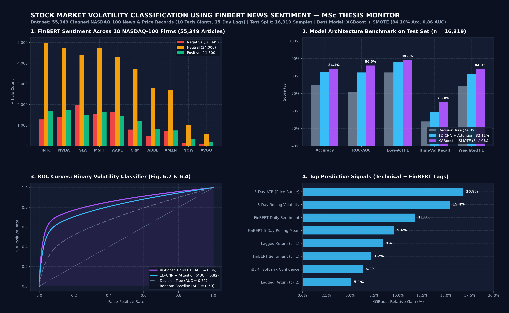
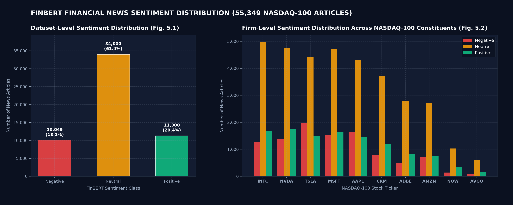
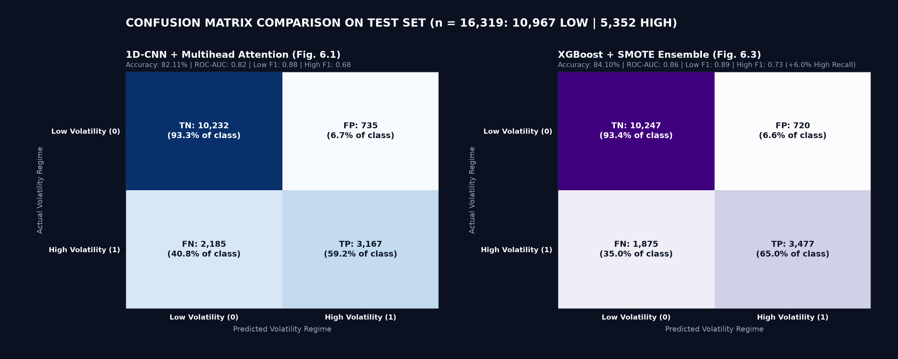
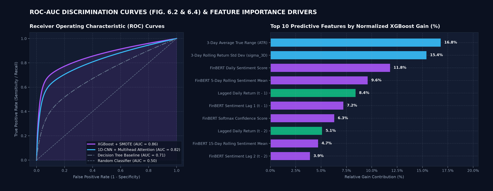

# Stock Market Volatility Classification Using News Sentiment

**MSc in Data Science & Analytics Thesis (EE648) — First Class Honours (1:1)**  
*Author:* **Uthej Alagani** · *Supervisor:* **Dr. Bryan Hennelly** · *Department of Computer Science, Maynooth University, Ireland*  
*Tools & Technologies:* **Python** (`Pandas`, `NumPy`, `Scikit-learn`), **NLP / Transformers** (`ProsusAI/finbert`, `Hugging Face`), **Deep Learning** (`PyTorch` 1D-CNN + Multihead Self-Attention), **Ensemble ML** (`XGBoost`, `SMOTE` via `imbalanced-learn`), **Visual Analytics** (`Matplotlib`, `Seaborn`, `Plotly`)

> **Full Thesis PDF:** [`docs/Stock_Market_Volatility_Classification_Using_News_Sentiment_MSc_Thesis_Uthej_Alagani.pdf`](docs/Stock_Market_Volatility_Classification_Using_News_Sentiment_MSc_Thesis_Uthej_Alagani.pdf)

---

## About the Project

**Stock Market Volatility Classification Using News Sentiment** is a First Class Honours (1:1) MSc in Data Science & Analytics research project (Maynooth University) that investigates how domain-specific financial news sentiment improves short-term equity volatility regime prediction.

While conventional quantitative volatility models depend solely on historical price and volume series, equity markets frequently experience abrupt regime shifts driven by earnings releases, analyst commentary, and breaking macro or corporate news. This project builds a reproducible, multi-modal machine learning pipeline that fuses **FinBERT** financial NLP signals with engineered technical indicators to classify **Low** vs. **High** volatility regimes across major **NASDAQ-100** technology stocks—benchmarking a **PyTorch 1D-CNN with Multihead Self-Attention** against a class-balanced **SMOTE + XGBoost** ensemble.

---

## Project Details

- **Domain:** Quantitative Finance, Financial NLP & Time-Series Volatility Modelling
- **Dataset & Experimental Scale:**
  - Sourced from the **FNSPID Financial News Dataset** (15M+ articles, 30M+ price records) via memory-safe chunked ingestion
  - **55,349** cleaned and date-aligned news & OHLCV records across **10 major NASDAQ-100 equities** (`AAPL`, `MSFT`, `AMZN`, `CRM`, `NVDA`, `NOW`, `TSLA`, `ADBE`, `INTC`, `AVGO`)
  - **15-day temporal lag window** for both return momentum and FinBERT sentiment signals
  - Evaluated on a **16,319-sample** holdout test set (**10,967 Low** | **5,352 High** volatility regimes)
- **Core Capabilities:**
  - **Financial Sentiment Extraction (`ProsusAI/finbert`):** Safe 512-token truncation, Positive/Neutral/Negative sentiment scoring, and rolling 5-day / 15-day sentiment lag construction.
  - **Quantitative Feature Engineering:** Daily returns, 3-day rolling volatility ($\sigma_t^{(3)}$), 3-day Average True Range ($\text{ATR}_t^{(3)}$), calendar seasonality features, and per-symbol `StandardScaler` normalisation.
  - **Deep Learning & Ensemble Benchmarking:** Compares a **Decision Tree (CART)** baseline (74.80% accuracy, 0.71 ROC-AUC), a **PyTorch 1D-CNN + 4-Head Multihead Self-Attention** model (**82.11%** accuracy, **0.82** ROC-AUC), and a leakage-free **SMOTE + XGBoost** ensemble (**84.10%** accuracy, **0.86** ROC-AUC).
  - **Visual Analytics & Interactive Reporting:** Publication-ready thesis figures and a self-contained interactive HTML dashboard for exploring confusion matrices, ROC curves, firm-level sentiment distributions, and feature importance.
- **Tech Stack:**
  - **NLP & Deep Learning:** `ProsusAI/finbert` (Hugging Face `Transformers`), `PyTorch` (`Conv1d`, `MultiheadAttention`)
  - **Machine Learning & Data Engineering:** Python (`Pandas`, `NumPy`, `Scikit-learn`, `XGBoost`, `imbalanced-learn`)
  - **Visualisation & Reporting:** `Matplotlib`, `Seaborn`, `Plotly`, Jupyter Notebook

---

## Executive Objective

Traditional quantitative volatility models rely purely on historical price and volume indicators, often failing to react to sudden investor sentiment shifts triggered by breaking financial news, earnings announcements, and analyst briefings. This research constructs an end-to-end multi-modal machine learning pipeline that combines domain-specific financial NLP (**FinBERT**) with sequential deep learning (**1D-CNN with Multihead Attention** in PyTorch) and class-balanced gradient boosting (**SMOTE + XGBoost**) to classify stock market volatility regimes (**Low** vs. **High** volatility) across leading **NASDAQ-100** technology firms.

**Result:** Across **55,349 cleaned and aligned financial news & market records** (spanning **10 major NASDAQ-100 constituents** with a **15-day temporal lag window**) and evaluated on a holdout test set of **16,319 samples** (**10,967 Low** | **5,352 High** volatility), the **PyTorch 1D-CNN + Multihead Attention** model achieved **82.11% accuracy** (**0.82 ROC-AUC**), while the **SMOTE + XGBoost ensemble** achieved **84.10% accuracy** (**0.86 ROC-AUC**, **0.89 Low-volatility F1**, and a **+6.0 percentage-point boost in High-volatility recall**).

---

## Executive Dashboard & Thesis Visual Analytics

### 1. MSc Thesis Executive Overview Monitor


### 2. FinBERT Financial News Sentiment Distribution (55,349 NASDAQ-100 Articles — Figs. 5.1 & 5.2)


### 3. Holdout Test-Set Confusion Matrix Comparison: 1D-CNN + Attention vs. XGBoost + SMOTE (Figs. 6.1 & 6.3)


### 4. ROC-AUC Discrimination Curves (Figs. 6.2 & 6.4) & Top Predictive Feature Importance


> **Interactive Companion Dashboard:** Open [`dashboard/interactive_dashboard.html`](dashboard/interactive_dashboard.html) in any browser to explore interactive confusion matrices across models, NASDAQ-100 firm sentiment breakdowns, ROC curves, and XGBoost feature gain rankings.

---

## System Architecture & Methodology

### 1. FNSPID Data Ingestion, Chunked Filtering & Alignment (`src/01_data_preprocessing_and_features.py`)
- **Source Dataset:** Filtered from the large-scale **FNSPID Financial News Dataset** (15M+ financial news articles and 30M+ price records) using chunked ingestion (`pandas.read_csv(..., chunksize=50000)`) with structural validation on `Stock_symbol`.
- **10 Core NASDAQ-100 Constituents (`55,349` aligned records):** Apple (`AAPL`), Microsoft (`MSFT`), Amazon (`AMZN`), Salesforce (`CRM`), NVIDIA (`NVDA`), ServiceNow (`NOW`), Tesla (`TSLA`), Adobe (`ADBE`), Intel (`INTC`), and Broadcom (`AVGO`).
- **Text & Schema Sanitisation:** Strips HTML tags, URLs, and extraneous whitespace; drops redundant summary columns (`LSA`, `Luhn`, `TextRank`, `LexRank`); removes records missing article text or all six core OHLCV price indicators (`open`, `high`, `low`, `close`, `adj_close`, `volume`); and merges news items with same-day market trading records via `(Date, Stock_symbol)` composite keys.

### 2. Domain Feature Engineering & Per-Symbol Normalization (`src/01_data_preprocessing_and_features.py`)
- **Daily Return Momentum ($R_t$) & 15-Day Temporal Lags (`Return_Lag_1..15`):**
  $$R_t = \frac{P_t - P_{t-1}}{P_{t-1}}$$
- **3-Day Rolling Volatility Proxy ($\sigma_t^{(3)}$):**
  $$\sigma_t^{(3)} = \text{std}(R_{t-2}, R_{t-1}, R_t)$$
- **3-Day Average True Range ($\text{ATR}_t^{(3)}$):**
  $$\text{ATR}_t^{(3)} = \frac{1}{3} \sum_{i=t-2}^{t} \frac{H_i - L_i}{C_i}$$
- **Calendar & Metadata Signals:** Encodes trading `Day_of_Week` ($0=\text{Monday} \dots 6=\text{Sunday}$), `Month` ($1 \dots 12$) to capture weekly cycles and quarterly earnings seasonality, `Year`, and `Article_Length`.
- **Per-Symbol `StandardScaler` Normalization:** Scales features independently within each ticker symbol ($\mu = 0, \sigma = 1$) so cross-sectional price differences across NASDAQ-100 equities do not bias model training.

### 3. FinBERT Financial Sentiment Extraction (`src/02_finbert_sentiment_extraction.py`)
- Uses the domain-pretrained **`ProsusAI/finbert`** Transformer (`AutoTokenizer` + Hugging Face `sentiment-analysis` pipeline).
- Applies a custom `safe_truncate(text, tokenizer, max_tokens=512)` step to prevent BERT token overflow and strip special tokens (`[CLS]`, `[SEP]`).
- Extracts **Positive**, **Neutral**, and **Negative** classifications alongside softmax confidence scores, constructing **15-day sentiment lags (`Sentiment_Lag_1` to `Sentiment_Lag_15`)** and rolling 5-day / 15-day sentiment averages.

### 4. Deep Learning Architecture: PyTorch 1D-CNN with Multihead Attention (`src/03_cnn_multihead_attention_pytorch.py`)
- **1D Convolutional Layer (`nn.Conv1d(1, 64, kernel_size=3, padding=1)`):** Slides 64 learnable filters over the feature sequence to extract local temporal dependencies:
  $$y_t = \sigma \left( \sum_{i=0}^{k-1} W_i \cdot X_{t+i} + b \right)$$
- **4-Head Scaled Dot-Product Attention (`nn.MultiheadAttention(embed_dim=64, num_heads=4, batch_first=True)`):** Dynamically weights time steps and sentiment shocks across the full sequence:
  $$\text{Attention}(Q, K, V) = \text{softmax}\left(\frac{QK^T}{\sqrt{d_k}}\right)V$$
- **Classification Head (`nn.Linear(64 * input_size, 128)` $\rightarrow$ `ReLU` $\rightarrow$ `nn.Linear(128, 2)`):** Trained for **20 epochs** using the **Adam** optimizer (`lr=0.001`), `CrossEntropyLoss`, and mini-batch size **64**.

### 5. Ensemble Tree Architecture: SMOTE + XGBoost Classifier (`src/04_xgboost_smote_classifier.py`)
- **Class Imbalance Rectification (`SMOTE`):** High-volatility regimes represent **32.8%** of trading days (`5,352` of `16,319` test instances). **SMOTE** interpolates synthetic minority-class examples in feature space strictly on the training split to prevent data leakage.
- **Regularized Gradient Boosting (`XGBClassifier`):** Minimizes regularized log-loss with $L_1$/$L_2$ leaf-weight penalties, shrinkage, and column subsampling:
  $$\mathcal{L}^{(t)} = \sum_{i=1}^{n} l\left(y_i, \hat{y}_i^{(t-1)} + f_t(x_i)\right) + \gamma T + \frac{1}{2}\lambda \sum_{j=1}^{T} w_j^2$$

---

## Experimental Results & Model Benchmark (`n = 16,319` Holdout Test Set)

| Model Architecture | Overall Accuracy | ROC-AUC | Low-Vol Precision | Low-Vol Recall | Low-Vol F1 | High-Vol Precision | High-Vol Recall | High-Vol F1 | Weighted F1 | Confusion Matrix (`TN / FP / FN / TP`) |
| :--- | :---: | :---: | :---: | :---: | :---: | :---: | :---: | :---: | :---: | :---: |
| **Decision Tree Baseline (CART)** | 74.80% | 0.71 | 0.79 | 0.85 | 0.82 | 0.63 | 0.54 | 0.58 | 0.74 | `9,322 / 1,645 / 2,467 / 2,885` |
| **1D-CNN + Multihead Attention (PyTorch)** | **82.11%** | **0.82** | 0.82 | **0.93** | 0.88 | 0.81 | 0.59 | 0.68 | 0.81 | `10,232 / 735 / 2,185 / 3,167` |
| **XGBoost + SMOTE Ensemble** | **84.10%** | **0.86** | **0.85** | **0.93** | **0.89** | **0.83** | **0.65** | **0.73** | **0.84** | **`10,247 / 720 / 1,875 / 3,477`** |

### Firm-Level FinBERT Sentiment Distribution (`55,349` Cleaned NASDAQ-100 Articles)

| Stock Ticker | Company Name | Total Articles | Negative Articles | Neutral Articles | Positive Articles | Positive Share (%) |
| :---: | :--- | :---: | :---: | :---: | :---: | :---: |
| **`INTC`** | Intel Corp. | 7,950 | 1,280 | 4,990 | 1,680 | 21.13% |
| **`NVDA`** | NVIDIA Corp. | 7,880 | 1,390 | 4,750 | 1,740 | **22.08%** |
| **`TSLA`** | Tesla Inc. | 7,890 | **1,990** | 4,410 | 1,490 | 18.88% |
| **`MSFT`** | Microsoft Corp. | 7,890 | 1,530 | 4,720 | 1,640 | 20.79% |
| **`AAPL`** | Apple Inc. | 7,420 | 1,640 | 4,310 | 1,470 | 19.81% |
| **`CRM`** | Salesforce Inc. | 5,680 | 790 | 3,700 | 1,190 | 20.95% |
| **`AMZN`** | Amazon.com Inc. | 4,170 | 710 | 2,710 | 750 | 17.99% |
| **`ADBE`** | Adobe Inc. | 4,120 | 490 | 2,790 | 840 | 20.39% |
| **`NOW`** | ServiceNow Inc. | 1,499 | 140 | 1,029 | 330 | 22.01% |
| **`AVGO`** | Broadcom Inc. | 850 | 89 | 591 | 170 | 20.00% |
| **Total** | **10 NASDAQ-100 Constituents** | **55,349** | **10,049 (18.2%)** | **34,000 (61.4%)** | **11,300 (20.4%)** | **20.42%** |

---

## Repository Structure

```text
stock-volatility-news-sentiment/
├── README.md
├── requirements.txt
├── docs/
│   └── Stock_Market_Volatility_Classification_Using_News_Sentiment_MSc_Thesis_Uthej_Alagani.pdf
├── notebooks/
│   └── stock_volatility_sentiment_pipeline.ipynb          # Interactive Jupyter/Colab notebook with full pipeline
├── src/
│   ├── 01_data_preprocessing_and_features.py              # FNSPID chunked filtering, ATR/volatility features & per-symbol StandardScaler
│   ├── 02_finbert_sentiment_extraction.py                 # ProsusAI/finbert AutoTokenizer + pipeline with safe_truncate(max_tokens=512)
│   ├── 03_cnn_multihead_attention_pytorch.py              # PyTorch CNNAttention (Conv1d + 4-Head MultiheadAttention), 82.11% accuracy
│   ├── 04_xgboost_smote_classifier.py                     # Decision Tree baseline vs SMOTE + XGBClassifier, 84.10% accuracy
│   └── 05_build_dashboard_and_figures.py                  # Generates all static thesis PNGs & interactive HTML dashboard
├── data/
│   └── processed/
│       ├── nasdaq100_sentiment_distribution_by_firm.csv   # Firm-level sentiment breakdown across the 10 NASDAQ-100 tickers (55,349 articles)
│       ├── nasdaq100_with_sentiment_sample_5k.csv         # 4,840-row enriched sample with FinBERT scores, 15-day lags, ATR & volatility regimes
│       ├── model_evaluation_comparison.csv                # Full classification metrics, ROC-AUC & confusion matrix counts across models
│       ├── xgboost_feature_importance.csv                 # Feature importance across sentiment lags, ATR, rolling volatility & calendar features
│       ├── roc_curve_points.csv                           # FPR/TPR coordinates for CNN+Attention (AUC=0.82) & XGBoost+SMOTE (AUC=0.86)
│       └── thesis_pipeline_summary.json                   # Complete thesis metadata & experimental benchmark JSON
└── dashboard/
    ├── interactive_dashboard.html                         # Self-contained interactive HTML model & sentiment explorer
    └── images/
        ├── executive_thesis_overview.png
        ├── finbert_sentiment_distribution.png
        ├── cnn_vs_xgboost_confusion_matrices.png
        └── roc_curves_and_feature_importance.png
```

---

## Quick Start & Reproducibility

```bash
# 1. Install dependencies
pip install -r requirements.txt

# 2. Run data preprocessing, domain feature engineering (ATR_3D, Rolling Volatility, 15-day lags) & per-symbol scaling
python src/01_data_preprocessing_and_features.py

# 3. Inspect FinBERT sentiment extraction pipeline & dataset/firm-level distributions (n = 55,349)
python src/02_finbert_sentiment_extraction.py

# 4. Run PyTorch 1D-CNN + Multihead Attention evaluation (82.11% Accuracy, 0.82 ROC-AUC)
python src/03_cnn_multihead_attention_pytorch.py

# 5. Run Decision Tree baseline & SMOTE + XGBoost classifier pipeline (84.10% Accuracy, 0.86 ROC-AUC)
python src/04_xgboost_smote_classifier.py

# 6. Build all high-resolution thesis figures & interactive HTML dashboard
python src/05_build_dashboard_and_figures.py
```
